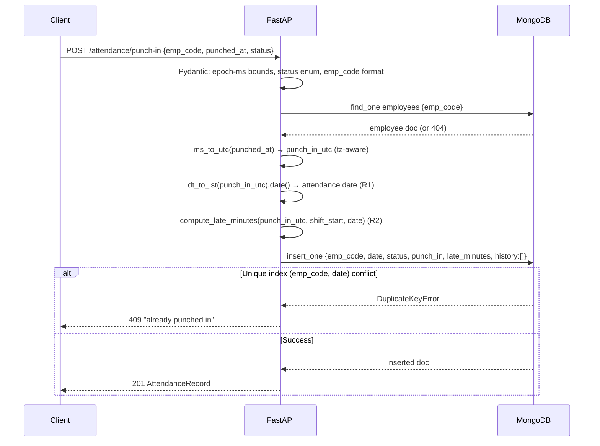
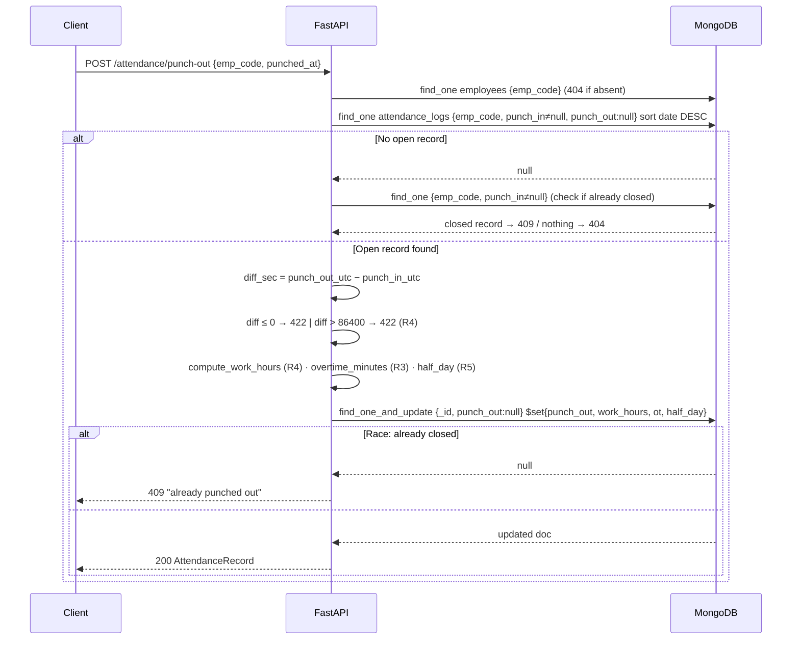
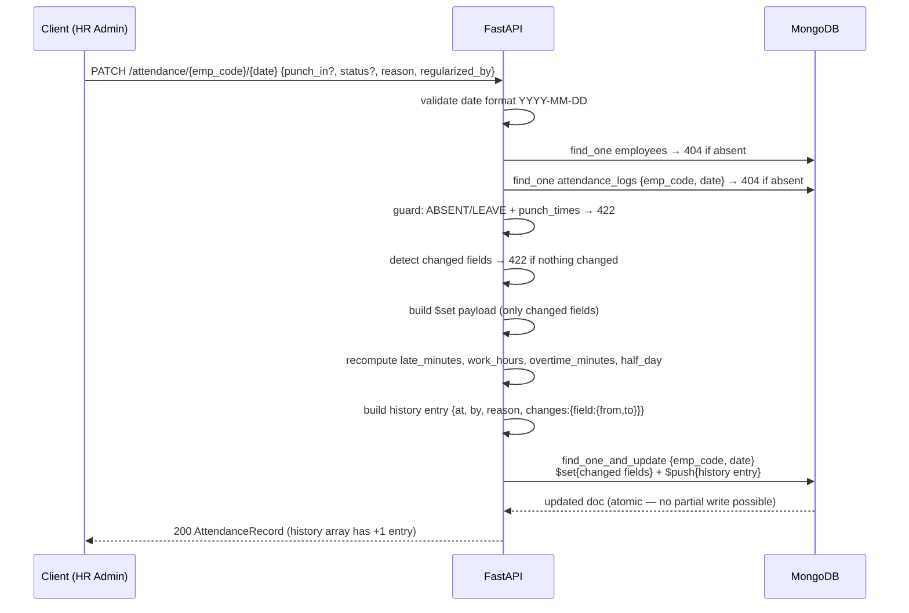
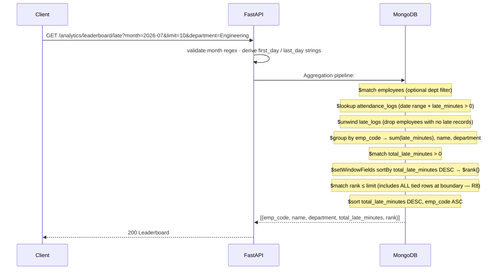

# Employee Attendance & Analytics API

## Overview

A backend for **recording employee attendance and analysing it** — punch-in and punch-out with
business rules, manual corrections with a full audit trail, and rich analytics built entirely on
MongoDB aggregation pipelines.

The design goal is **correctness under concurrency**: simultaneous punch-in requests, duplicate
regularisations, and invalid state combinations all leave the data consistent, and the important
guarantees are enforced by **MongoDB unique indexes and atomic operations**, not just Python `if`
statements.

**Stack:** Python 3.11 · FastAPI · Pydantic v2 · PyMongo 4.7 · MongoDB 6.0 · Pytest · Uvicorn.

## Features

### Core assignment features

| Requirement | Where |
|---|---|
| Employee management (create, list, paginate, filter) | `POST /employees`, `GET /employees` |
| Punch-in with IST date, late-minutes (R1–R2) | `POST /attendance/punch-in` |
| Punch-out with work-hours, overtime, half-day (R3–R5) | `POST /attendance/punch-out` |
| Duplicate punch-in → exactly one 201, one 409 under concurrency (R6) | unique compound index + `DuplicateKeyError` |
| Manual correction with full audit trail and derived-field recomputation (R7) | `PATCH /attendance/{emp_code}/{date}` |
| Employee monthly summary | `GET /analytics/employees/{emp_code}/monthly` |
| Department summary with headcount, attendance %, late stats | `GET /analytics/departments/summary` |
| Late-comers leaderboard with standard competition ranking and tie handling (R8) | `GET /analytics/leaderboard/late` |
| Daily department trend with gap-filling and 7-day moving average (R9) | `GET /analytics/departments/{department}/trend` |
| MongoDB explain plans for every aggregation | `GET /admin/explain/{endpoint}` |
| Code review of starter `app/main.py` (11 bugs found and fixed) | `REVIEW.md` |
| Design decision rationale | `DECISIONS.md` |

### Engineering features

| Feature | Why it is here |
|---|---|
| **Zero in-memory aggregation** | all analytics run inside MongoDB (`$lookup`, `$group`, `$rank`, `$densify`, `$setWindowFields`) |
| **Race-free concurrency** | unique index on `(emp_code, date)` is the single serialisation point — no check-then-insert |
| **Atomic audit trail** | `$push` and `$set` in one `find_one_and_update` — no partial writes |
| **Idempotent index creation** | all indexes created with `create_index` at startup; safe to restart |
| **Full test suite** | 92 tests, session-scoped DB isolation, per-test collection wipe |
| **IST-aware date logic** | all calendar dates derived in IST regardless of server timezone |
| **OpenAPI / Swagger** at `/docs` | self-documenting, all schemas and examples present |

---

## Architecture

```
┌──────────────────────────────────────────────────────────────┐
│                       Client (HTTP)                          │
└───────────────────────────┬──────────────────────────────────┘
                            │  REST / JSON
┌───────────────────────────▼──────────────────────────────────┐
│                   FastAPI Application                        │
│                                                              │
│  ┌────────────────┐  ┌─────────────────┐  ┌──────────────┐  │
│  │ Pydantic v2    │  │  Route handlers │  │   Business   │  │
│  │ Validation     │─▶│  (thin layer)   │─▶│   Logic      │  │
│  └────────────────┘  └────────┬────────┘  │  (R1 – R9)   │  │
│                               │           └──────────────┘  │
│                       ┌───────▼───────┐                     │
│                       │  PyMongo 4.7  │                     │
│                       │  (sync)       │                     │
│                       └───────┬───────┘                     │
└───────────────────────────────┼─────────────────────────────┘
                                │  Wire Protocol
┌───────────────────────────────▼─────────────────────────────┐
│                    MongoDB 6.0+                              │
│                                                              │
│   ┌───────────────────┐    ┌───────────────────────────┐    │
│   │   employees       │    │   attendance_logs          │    │
│   │                   │    │                            │    │
│   │ idx_emp_code      │    │ idx_emp_date (unique)      │    │
│   │   (unique)        │    │ idx_date_emp (sort/list)   │    │
│   │ idx_department    │    │ idx_status                 │    │
│   │ idx_joined_on     │    │                            │    │
│   └───────────────────┘    └───────────────────────────┘    │
└─────────────────────────────────────────────────────────────┘
```

**Layer responsibilities:**

| Layer | Responsibility |
|---|---|
| **Route handler** | HTTP input/output only — validate, call service, return response |
| **Business logic** (inline) | business rules R1–R9, state checks, derived-field computation |
| **PyMongo** | queries, aggregation pipelines, atomic updates |
| **MongoDB** | uniqueness constraints, indexes, aggregation execution |

---

## Request / Response Workflows

### Punch-In



### Punch-Out



### Regularize (Audit Trail)



### Analytics — Late Leaderboard



---

## Data Model

### `employees` collection

| Field | Type | Constraint | Notes |
|---|---|---|---|
| `emp_code` | String | Unique index | Format `EMP\d{4,6}` |
| `name` | String | 1–100 chars | |
| `email` | String | Unique | Pattern validated |
| `department` | String | 1–50 chars | |
| `joined_on` | String | `YYYY-MM-DD` | Used as headcount boundary in trend |
| `shift_start` | String | `HH:MM` IST | |
| `shift_end` | String | `HH:MM` IST | `end ≤ start` → overnight shift |
| `created_at` | DateTime | UTC | Set at creation |

### `attendance_logs` collection

| Field | Type | Constraint | Notes |
|---|---|---|---|
| `emp_code` | String | Compound unique with `date` | |
| `date` | String | Compound unique with `emp_code` | IST calendar day `YYYY-MM-DD` |
| `status` | String | Enum | `PRESENT / ABSENT / LEAVE / WFH / ON_DUTY` |
| `punch_in` | DateTime (UTC) | | Null for ABSENT/LEAVE |
| `punch_out` | DateTime (UTC) | | Null until punched out |
| `work_hours` | Float | | Null until punch-out; half-up 2 dp |
| `late_minutes` | Int | ≥ 0 | Floor whole minutes after grace period |
| `overtime_minutes` | Int | ≥ 0 | 0 if < 30 min past shift end |
| `half_day` | Bool | | `True` when `work_hours < 4.50` |
| `history` | Array | Append-only | Audit trail of regularizations |

### History entry schema

```json
{
  "at": 1783312500000,
  "by": "hr.admin",
  "reason": "biometric glitch",
  "changes": {
    "punch_in": { "from": 1783312800000, "to": 1783310280000 },
    "late_minutes": { "from": 35, "to": 0 }
  }
}
```

---

## Business Rules

| Rule | Specification | Implementation |
|---|---|---|
| **R1** | Attendance date = IST calendar day of punch-in; overnight shifts land on the next IST day | `dt_to_ist(punch_utc).date()` — server-timezone independent |
| **R2** | `late_minutes = floor((punch_in − shift_start) / 60)`; ≤ 10 min grace → 0 | `compute_late_minutes()` — constructs shift-start as IST-aware instant |
| **R3** | `overtime_minutes = floor((punch_out − shift_end) / 60)`; < 30 min → 0; overnight shift_end placed on next day | `compute_overtime_minutes_with_start()` |
| **R4** | `work_hours = elapsed_seconds / 3600`, half-up to 2 dp; punch_out must be after punch_in and within 24 h | `compute_work_hours()` + boundary checks in punch-out handler |
| **R5** | `half_day = work_hours < 4.50` (strict less than) | `compute_half_day()` |
| **R6** | One record per employee per calendar day; concurrent duplicate punch-ins → exactly one 201, rest 409 | Unique compound index `(emp_code, date)` + catch `DuplicateKeyError` from `insert_one` |
| **R7** | Regularization appends one history entry with before/after values; derived fields recomputed | `$push` + `$set` in a single `find_one_and_update` — atomic, no partial write |
| **R8** | Leaderboard: standard competition ranking; ties at the limit boundary → all tied rows included | `$setWindowFields $rank` then `$match rank ≤ limit` |
| **R9** | Trend headcount = employees where `joined_on ≤ that calendar day` | `$lookup` with `joined_on` boundary filter |

---

## MongoDB Index Strategy

```python
# employees
employees.create_index([("emp_code", ASC)], unique=True)      # PK — every lookup, unique guard
employees.create_index([("department", ASC)])                  # dept filter in all analytics
employees.create_index([("joined_on",  ASC)])                  # headcount range in trend

# attendance_logs
attendance_logs.create_index(
    [("emp_code", ASC), ("date", ASC)], unique=True            # natural key + race guard (R6)
)
attendance_logs.create_index(
    [("date", DESC), ("emp_code", ASC)]                        # list sort — no in-memory sort
)
attendance_logs.create_index([("status", ASC)])                # status filter on list endpoint
```

**Key decisions:**

- The compound unique index on `(emp_code, date)` is the **only** thing preventing duplicate punch-ins under concurrency. No check-then-insert pattern exists.
- `(date DESC, emp_code ASC)` matches the required list sort exactly; MongoDB can satisfy it index-only.
- `(emp_code, date)` also satisfies `emp_code`-only prefix lookups via left-prefix rule, so no separate `emp_code` index is needed.
- All indexes are created with `create_index` (idempotent) inside the `lifespan` startup context manager.

---

## Aggregation Pipelines

| Endpoint | Pipeline stages | Special operators |
|---|---|---|
| Employee monthly | `$match` → `$group` | Conditional `$sum` with half-day weight (`$cond`) |
| Department summary | `$match` → `$lookup` → `$unwind` (preserve nulls) → `$group` → `$sort` | `$addToSet` for headcount dedup; `preserveNullAndEmptyArrays: True` keeps employees with no logs |
| Late leaderboard | `$match` → `$lookup` → `$unwind` → `$group` → `$match` → `$setWindowFields` → `$match` → `$sort` | `$rank` window function; no Python sorting |
| Department trend | `$match` → `$lookup` → `$unwind` → `$group` → `$densify` → `$lookup` → `$sort` → `$setWindowFields` | `$densify` for gap-filling; `$avg` sliding window for 7-day MA |
| Explain | Same pipeline per endpoint with `explain=True` | `bson.json_util.dumps` for BSON-safe serialisation |

**Zero Python-side aggregation loops.** Every sum, rank, moving average and gap-fill runs inside MongoDB.

---

## Edge Cases

| Situation | Behaviour |
|---|---|
| **Concurrent duplicate punch-in** (5 simultaneous requests) | Unique index serialises them: exactly one `insert_one` wins → 201; rest raise `DuplicateKeyError` → 409. Tested with 5 threads. |
| **Punch-out before punch-in** | Validation: `punch_out_utc ≤ punch_in_utc` → `422 punched_at must be after punch_in`. |
| **Punch-out > 24 hours after punch-in** | `422 punched_at must be within 24 hours of punch_in`. |
| **Double punch-out** | `find_one_and_update` with filter `{punch_out: null}` returns `None` → `409 already punched out`. Atomic — no race window. |
| **Regularize with no effective change** | Detects that the proposed values equal the stored values → `422`. |
| **Regularize ABSENT/LEAVE + punch times** | `422 Cannot set punch times for ABSENT or LEAVE status`. |
| **Regularize unknown employee or record** | `404` in both cases. |
| **Leaderboard ties at limit boundary** | `$match rank ≤ limit` returns all tied rows; response may have more items than `limit`. |
| **Department trend missing days** | `$densify` fills every calendar day in the requested range; days with no records get `present_count = 0`, `late_count = 0`, `attendance_rate = null` on weekends and `0.0` on weekdays with headcount > 0. |
| **7-day moving average on first rows** | Window is bounded to rows within the requested range; the first rows use a shorter window of however many non-null rates exist. |
| **Unknown department in trend** | `404` if no employees belong to that department. |
| **explain endpoint binary BSON** | `bson.json_util.dumps` + `json.loads` converts ObjectIds, datetimes and all BSON types cleanly before FastAPI serialises the response. |
| **Health endpoint with MongoDB down** | `client.admin.command("ping")` raises → `503 Service Unavailable`. Unconditional 200 was a bug in the starter code (Bug #9 in REVIEW.md). |

---

## Prerequisites

- Python **3.11+**
- MongoDB **6.0 or newer** — local, Docker, or [Atlas free M0](https://www.mongodb.com/atlas)
  - `$densify` requires 5.1+; `$setWindowFields $rank` requires 5.0+; both are present in 6.0+
- Git

---

## Installation & Setup

```bash
git clone https://github.com/Divyansh8843/HROne_Assignment.git
cd HROne_Assignment

# Create virtual environment
python -m venv .venv

# Activate — Windows
.venv\Scripts\activate
# Activate — Linux / macOS
source .venv/bin/activate

# Install dependencies
pip install -r requirements.txt
```

### Seed sample data (optional)

```bash
python sample_seed.py
```

Loads 6 employees and 9 attendance records into `attendance_db`. The grader uses a **larger hidden
dataset** — the sample only verifies document shape.

---

## Environment Variables

Create a `.env` file in the project root (never commit it — it is in `.gitignore`):

```dotenv
# MongoDB connection string (local or Atlas)
MONGO_URI=mongodb://localhost:27017
# OR Atlas:
# MONGO_URI=mongodb+srv://<user>:<pass>@<cluster>.mongodb.net/?retryWrites=true&w=majority

# Database name
MONGO_DB=attendance_db
```

| Variable | Default | Purpose |
|---|---|---|
| `MONGO_URI` | `mongodb://localhost:27017` | MongoDB connection string |
| `MONGO_DB` | `attendance_db` | Production database name |

> **Tests** automatically use a separate `attendance_test_db` database, dropped before and after the session — they never touch the production database.

---

## Running the API

```bash
uvicorn app.main:app --port 8000 --reload
```

| URL | Description |
|---|---|
| `http://localhost:8000/docs` | Swagger UI (interactive) |
| `http://localhost:8000/redoc` | ReDoc documentation |
| `http://localhost:8000/health` | MongoDB ping / readiness probe |

All indexes are created idempotently at startup. The API is ready to serve immediately after the startup log appears.

---

## Example API Requests

```bash
BASE=http://localhost:8000

# 1. Create an employee
curl -s -X POST $BASE/employees -H 'Content-Type: application/json' \
  -d '{"emp_code":"EMP0001","name":"Asha Verma","email":"asha@example.com",
       "department":"Engineering","joined_on":"2024-01-15",
       "shift_start":"09:30","shift_end":"18:30"}'

# 2. Punch in (punched_at is epoch milliseconds IST 09:28)
curl -s -X POST $BASE/attendance/punch-in -H 'Content-Type: application/json' \
  -d '{"emp_code":"EMP0001","punched_at":1783297080000,"status":"PRESENT"}'

# 3. Punch out (18:35 IST → 9h7m = 9.12 work_hours, 0 overtime < 30 min)
curl -s -X POST $BASE/attendance/punch-out -H 'Content-Type: application/json' \
  -d '{"emp_code":"EMP0001","punched_at":1783329300000}'

# 4. Regularize a record (HR corrects punch-in time)
curl -s -X PATCH $BASE/attendance/EMP0001/2026-07-06 -H 'Content-Type: application/json' \
  -d '{"punch_in":1783295280000,"reason":"biometric glitch","regularized_by":"hr.admin"}'

# 5. List attendance (paginated, sorted date DESC)
curl -s "$BASE/attendance?emp_code=EMP0001&page=1&page_size=10"

# 6. Employee monthly summary
curl -s "$BASE/analytics/employees/EMP0001/monthly?month=2026-07"

# 7. Department summary
curl -s "$BASE/analytics/departments/summary?month=2026-07"

# 8. Late-comers leaderboard with ties
curl -s "$BASE/analytics/leaderboard/late?month=2026-07&limit=5"

# 9. Department daily trend + 7-day moving average
curl -s "$BASE/analytics/departments/Engineering/trend?from=2026-07-01&to=2026-07-31"

# 10. MongoDB explain plan
curl -s "$BASE/admin/explain/late_leaderboard?month=2026-07"
```

---

## Running Tests

```bash
pytest tests/ -v
```

Expected:

```
92 passed in ~110 s
```

Tests connect to `attendance_test_db` and wipe both collections before and after every individual test (`wipe_collections` autouse fixture). No manual cleanup is needed between runs.

**Test coverage by class:**

| Class | Tests | What it covers |
|---|---|---|
| `TestHealth` | 1 | MongoDB ping, 503 on failure |
| `TestEmployees` | 9 | Create, duplicate 409, shift validation, list, sort, dept filter, pagination |
| `TestPunchIn` | 9 | IST date derivation, late_minutes, 10-min grace, status, race/409 |
| `TestPunchOut` | 13 | work_hours (R4), overtime thresholds (R3), half_day (R5), 422 guards, 409 double punch, overnight shift |
| `TestAttendanceList` | 7 | Date-desc+emp-asc sort, filter totals, date range, pagination |
| `TestRegularize` | 11 | History append, derived recompute, no-change 422, ABSENT+punch 422, short reason 422, 404s |
| `TestEmployeeMonthly` | 8 | Aggregation correctness, half-day weighting, empty month |
| `TestDepartmentSummary` | 7 | Cross-collection aggregation, headcount with no-log employees |
| `TestLateLeaderboard` | 11 | Ranking, ties at boundary, limit, dept filter, empty |
| `TestDepartmentTrend` | 10 | `$densify` gap-fill, headcount boundary (R9), weekend rows, 7-day MA, 404 |
| `TestExplain` | 5 | Explain plans returned, correct collection names, BSON serialisation |
| `TestConcurrency` | 1 | 5 simultaneous punch-ins → exactly one 201, rest 409 |
| `TestHelpers` | 2 | Epoch-ms conversion, half-up rounding |

---

## API Reference

Base path `/`. All error responses use standard FastAPI `detail` format.

| Method | Path | Auth | Status codes | Description |
|---|---|---|---|---|
| `GET` | `/health` | Public | 200, 503 | MongoDB ping |
| `POST` | `/employees` | Public | 201, 409, 422 | Create employee |
| `GET` | `/employees` | Public | 200, 422 | List employees (paginated, sorted `emp_code` ASC) |
| `POST` | `/attendance/punch-in` | Public | 201, 404, 409, 422 | Punch in (R1–R2) |
| `POST` | `/attendance/punch-out` | Public | 200, 404, 409, 422 | Punch out (R3–R5) |
| `GET` | `/attendance` | Public | 200, 422 | List records (paginated, date DESC + emp_code ASC) |
| `PATCH` | `/attendance/{emp_code}/{date}` | Public | 200, 404, 422 | Regularize + audit trail (R7) |
| `GET` | `/analytics/employees/{emp_code}/monthly` | Public | 200, 404, 422 | Monthly summary |
| `GET` | `/analytics/departments/summary` | Public | 200, 422 | Department summary |
| `GET` | `/analytics/leaderboard/late` | Public | 200, 422 | Late leaderboard (R8) |
| `GET` | `/analytics/departments/{department}/trend` | Public | 200, 404, 422 | Daily trend + 7-day MA (R9) |
| `GET` | `/admin/explain/{endpoint}` | Public | 200, 422 | MongoDB explain plan |

Valid `{endpoint}` values: `attendance_list`, `employee_monthly`, `department_summary`, `late_leaderboard`, `department_trend`.

---

## Project Structure

```
candidate_kit/
├── app/
│   ├── __init__.py
│   └── main.py              ← Single-file implementation: models, validators,
│                              business logic R1–R9, all endpoints, aggregation pipelines
├── sample_data/
│   ├── employees.json        ← 6 sample employees
│   └── attendance_logs.json  ← 9 sample attendance records
├── tests/
│   ├── __init__.py
│   └── test_api.py           ← 92 tests, session-scoped DB, per-test wipe
├── sample_seed.py            ← Loads sample_data/ idempotently into MongoDB
├── openapi.yaml              ← Official API contract (provided, not modified)
├── DATA_MODEL.md             ← Field-level data model (provided)
├── REVIEW.md                 ← 11 bugs found & fixed in the starter code
├── DECISIONS.md              ← 5 design decisions with full rationale
├── requirements.txt          ← All dependencies
├── .gitignore                ← Excludes .env, __pycache__, .pytest_cache, .venv
└── README.md                 ← This file
```

> `.env` is intentionally excluded from the repository. Never commit secrets.

---

## Design Decisions

Full rationale in [DECISIONS.md](DECISIONS.md).

**Indexes.**
Five indexes cover every query pattern. The compound unique index on `(emp_code, date)` is both the natural key and the concurrency guard — it replaces the entire check-then-insert anti-pattern with a single atomic guarantee. The `(date DESC, emp_code ASC)` index matches the required list sort exactly so MongoDB never needs an in-memory sort stage. `(department)` and `(joined_on)` on employees accelerate the cross-collection aggregations.

**Race-free punch-in.**
Both concurrent requests reach `insert_one` at nearly the same instant. The unique compound index means only one can win; the other raises `DuplicateKeyError`. The winner returns 201; the loser returns 409. There is no check-then-insert, so the race window is zero. Tested with 5 threads.

**Standard competition ranking and ties.**
`$setWindowFields` with `$rank` assigns competition ranks (1, 2, 2, 4). The `$match {rank: {$lte: limit}}` stage runs *after* ranking, so all tied employees at the boundary are included. The response can legitimately contain more rows than `limit`. Rows are then sorted `total_late_minutes DESC, emp_code ASC` for determinism.

**Headcount with no-log employees.**
The department summary pipeline starts from `employees` (filtered by `joined_on ≤ last day of month`), then does a `$lookup` with `preserveNullAndEmptyArrays: True`. Employees with zero attendance logs survive the `$unwind` as a single row with `logs = null`, so they still contribute to the `$addToSet` headcount accumulator.

**100× scale improvement.**
The department trend headcount is currently computed with a per-day `$lookup`. At 100× data volume (millions of records, tens of thousands of employees) this is still server-side work, but the most impactful improvement would be replacing the Python-side moving-average post-processing loop with a purely aggregation-native solution using `$setWindowFields $avg` with an explicit documents window — keeping all work inside MongoDB regardless of the result-set size.

---

## Code Review (Starter `app/main.py`)

Full table with symptom and fix in [REVIEW.md](REVIEW.md). Summary of the 11 bugs found:

| # | Bug | Root cause |
|---|---|---|
| 1 | Pagination off by one | `skip = page * page_size` should be `(page - 1) * page_size` |
| 2 | Total ignores filters | `count_documents({})` should be `count_documents(q)` |
| 3 | No sort on employee list | Missing `.sort("emp_code", ASCENDING)` |
| 4 | Naive timestamp conversion | `datetime.fromtimestamp(ms/1000)` uses local TZ; must use `tz=UTC` |
| 5 | Attendance date in local TZ | `ts.date()` should derive from IST via `dt_to_ist(punch_utc).date()` |
| 6 | Race-prone duplicate check | `find_one` then `insert_one` — unique index catch replaced this |
| 7 | Late-minutes TypeError + off-by-one | Naive shift-start datetime + `> 10` instead of `≤ 600 seconds` |
| 8 | Overtime misses threshold + overnight | No 30-min minimum; no next-day placement for overnight shifts |
| 9 | Unconditional health 200 | No MongoDB ping; should be 503 on failure |
| 10 | Full collection load | `list(db.attendance_logs.find(q))` loads ~100k docs into RAM |
| 11 | Naive `created_at` | `datetime.now()` stores local time; must be `datetime.now(UTC)` |

---

## Known Limitations & Future Work

- **Sync PyMongo** is used throughout. For a production service under heavy concurrent load, migrating to **Motor** (async driver) would let FastAPI serve I/O concurrently without blocking event-loop threads.
- **No authentication / authorisation** — not required by the assignment. A production deployment would add JWT middleware and role-based access (e.g. only HR can regularize).
- **No rate limiting** — trivial to add as FastAPI middleware with a Redis counter.
- **Single-file implementation** — `app/main.py` contains everything. A larger production service would split into routers, services, repositories and schemas for independent testability.
- **Partial submissions:** None — all endpoints, business rules, aggregations, edge cases and tests are fully implemented.
